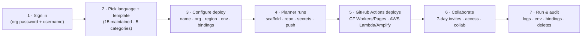
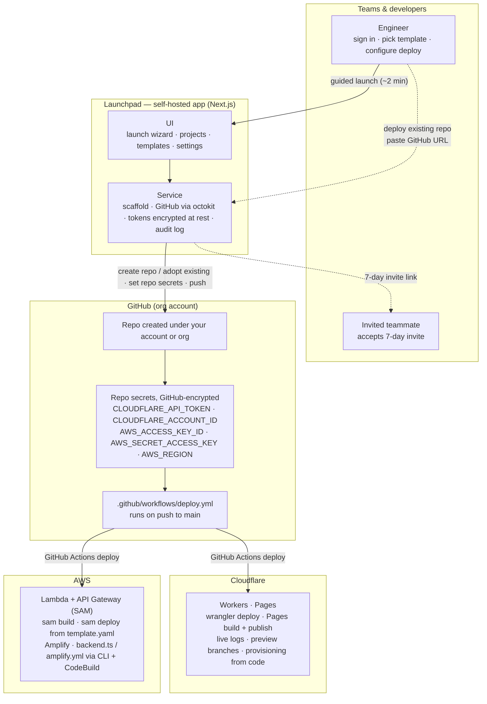

# Launchpad — Short Proposal

**Newpage Platform & Delivery · September 2026**

> **In one sentence —** Launchpad is an internal self-serve launcher that turns "new app idea" or prototype into a deployed, CI/CD-connected GitHub repo in about two minutes — on Cloudflare or AWS.

---

## What it is

- Launchpad is an internal self-serve platform for scaffolding apps and deploying them to **Cloudflare** (Workers and Pages) or **AWS** (Lambda + API Gateway via SAM, and Amplify).
- The whole flow is one guided launcher: **sign in → pick language and template → configure deployment →** Launchpad scaffolds the project, creates the GitHub repo (under the user's account or the configured org), sets provider credentials as encrypted repo secrets, and pushes the code.
- A **GitHub Actions workflow then deploys** to the chosen provider — every project ships with CI/CD attached, and the deploy is visible on the launch page.
- It is deliberately **not a PaaS or hosting platform**. Launchpad owns the path from "I want to ship this" to "it is live, versioned, and wired to CI/CD" — and nothing after. Teams keep owning the runtime.
- It also **adopts code that already exists**: paste a GitHub repo URL, Launchpad analyzes the framework and build steps, plans the move, and deploys it — usually to Pages — without moving the repo out of the owner's account.

## Who it is for

- **Individual engineers** who need a service, API, worker, or site up fast — without filing a platform ticket or remembering how the last repo was wired.
- **Tech leads and project owners** who onboard teammates, rotate access, and need deploy history, environment, bindings, and activity for the projects they own.
- **Platform, delivery, and security teams** who want every project to start from maintained templates, with consistent secrets handling, invite-based collaboration, and a complete audit trail.

## Why it should exist

- **Speed over hand-rolled setup.** Scaffolding a repo, wiring CI, and adding secrets costs an experienced engineer 30–60 minutes per project — and the result differs every time. Launchpad collapses that to roughly two minutes of guided clicks, identically every time.
- **Consistency beats tribal knowledge.** Templates, workflows, and config live in one reviewed, versioned place. Update a template once and every future project inherits the fix.
- **Security by default.** Least-privilege tokens, credentials encrypted at rest, provider keys stored as GitHub repo secrets (never returned by the API), invite links with expiry instead of ad-hoc access, and a tamper-evident audit log.
- **One surface for Cloudflare and AWS.** Workers/Pages and Lambda/Amplify side by side, so teams pick the runtime that fits the job — not the one someone remembers how to wire up.
- **It removes an entire class of onboarding churn.** New starters don't guess "how we did it last time" — they launch it.

---

## How it works — the process

1. **Sign in** with the shared org password and a username. The first user (or the configured admin) becomes the global admin.
2. **Choose "Launch":** pick a language and one of the 15 maintained templates across 5 categories (built-in, or scaffolded live from `create-cloudflare`).
3. **Configure:** project name, visibility, GitHub org target, AWS region and credentials, environment variables, and bindings; preview deployments and provisioning-from-code are one toggle each.
4. **Launchpad does the plumbing:** scaffolds the project, creates the GitHub repo under the org, encrypts any per-project tokens at rest, sets provider credentials as GitHub repo secrets, and pushes to `main`.
5. **GitHub Actions deploys:** `wrangler deploy` for Workers, Pages build + publish, SAM build/deploy for Lambda, Amplify for static/Next sites. The run is visible live on the launch page.
6. **Collaborate:** owners send single-use invite links (7-day TTL). Accepted invites grant Launchpad access and, with a GitHub handle, repo collaboration — admins get push, members get collaborator.
7. **Run & audit:** redeploys, env vars, bindings, live logs and preview branches (Cloudflare), and a full audit of every sign-in, launch, redeploy, and delete. Deleting tears down infra per provider.

> **Deploying an existing repo** uses the same plumbing and skips the scaffolding: paste a GitHub URL → Launchpad analyzes the framework and build steps → you review the plan (what it will do, build and deploy commands, env vars to fill) → deploy. Repos that aren't deployable get a guided fix list instead of a rejection — fix, push, re-analyze.

## Architecture

> Notes: preview deployments, provisioning, and live logs are Cloudflare-only features — they are hidden for AWS projects. Import targets Cloudflare Pages/Workers: the existing repo never moves, and Launchpad adds a deploy workflow and config to it. Launchpad runs on a Node host (local filesystem + spawns `create-cloudflare`): VPS, Docker, Fly.io, Railway, or Render — it cannot run on Workers/Pages itself.

## What's in scope

- 15 maintained templates across 5 categories, plus live scaffolders (`create-cloudflare`).
- Launch wizard with per-project deployment options: bindings, environment variables, AWS region and credentials, preview and provisioning-from-code toggles.
- Deploy an existing project: paste a GitHub URL, Launchpad analyzes it and plans the deploy — ready repos get a deploy plan, not-ready repos a guided fix list; the repo stays in place and deploys to Cloudflare.
- Projects table with search, filters, bulk actions, delete-with-confirmation, and per-project status.
- Project page with seven tabs: Overview, Deploy History, Environment, Bindings, Members, Access, Activity.
- Live logs (Cloudflare), Worker preview branches, and provisioning from code — KV / D1 / R2, AI Search, and Turnstile widgets created on push.
- Single-use invite links (7-day expiry) that grant Launchpad access and repo collaboration.
- Settings: provider security status, org & AWS configuration, and a full audit log of sign-ins, launches, redeploys, and deletes.

---
